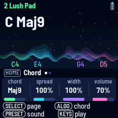

# Chordism for the M-VAVE FM-1

Chordism turns the M-VAVE FM-1 into a chord synth. Each key plays a chord of four voices, from sixteen chord types,
your own intervals, or a chord for each note of the scale. The voices run through morphing levels and pans, FM, a
filter that opens as you press harder, lo-fi, a delay and a stereo plate reverb, with an arpeggiator on top. It comes
with the Chordism module's 57 sounds, and you can keep 16 of your own.

For the controls, see the [manual](app/docs/MANUAL.md).

## Building

    git submodule update --init --recursive
    PYTHON=/opt/homebrew/bin/python3.14 ./build.sh     # app/build/chordism.fwsc
    sh tests/run_tests.sh                              # the engine against the original, the app in the simulator, the emulator, the words

The toolchain, the SDK and the build container are fm1-base's. For details, see base/README.md.

## Releasing

Releases are built, tested and signed on GitHub by `.github/workflows/release.yml` (the shared FM-1 builder,
zvenson/fm1-build@v1). Write the notes in a draft first, then push the tag:

    gh release create vX.Y --draft --title "Chordism X.Y" --notes "..."
    git push origin main vX.Y

Then publish the site from the attested package:

    gh release download vX.Y --pattern '*.fwsc' --dir app/build
    PYTHON=/opt/homebrew/bin/python3.14 tools/publish_pages.sh X.Y app/build/chordism-X.Y.fwsc

## Licence

MPL-2.0. The sound engine (app/dsp/) is the [Chordism module for Schwung](https://github.com/charlesvestal/schwung-chordism)
in C, under MIT. Built on [fm1-base](https://github.com/charlesvestal/fm1-base) and felucca-bsp, from
[Felucca](https://github.com/hugelton/Felucca) by Leo Kuroshita (Hügelton Instruments). Fonts: Barlow (SIL OFL 1.1).

M-VAVE and FM-1 are trademarks of their owners. Chordism is not affiliated with M-VAVE.
