# Chordism

Chordism turns your M-VAVE FM-1 into a chord synth. Each key plays a chord of four voices, built on the note you
press. You pick the kind of chord, how wide it's spread and how it sits in the stereo field, and the voices run
through a filter, a delay and a plate reverb. Press a key harder and the filter opens.

It's the Chordism module for Schwung, rebuilt for the FM-1. It comes with the module's 57 sounds, and you can keep
16 of your own.

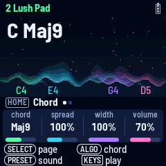

---

## Contents

1. Install
2. Playing
3. Getting around
4. The screen
5. Sounds and saving
6. The pages
7. MIDI, audio and Bluetooth
8. The screen reader
9. Credits

---

## 1. Install

To try Chordism first, open the emulator on Chordism's site. It runs the same code in your browser, with sound.

To install it, connect the FM-1 by USB, open the installer on Chordism's site in Chrome or Edge and press Install.
The browser asks once for permission to use MIDI, so allow it. Don't unplug the cable while it's writing.

Or, from a terminal, run `python3 base/tools/fm1_install.py chordism-VERSION.fwsc`.

To go back to M-VAVE's own firmware, use the last section of the installer.

---

## 2. Playing

Press any key to play a chord built on that note. Chordism plays one chord at a time. When you press a new key, its
chord takes over, and when you let go, the chord of the key you were still holding comes back.

How hard you strike a key sets its loudness, and pressing a held key harder opens the filter. On some sounds your
pressure moves more than the filter. For details, see Control.

Use OCT− and OCT+ to move the keys down or up an octave, up to three each way. Turn MASTER for the volume.

Press PLAY to turn the arpeggiator on or off. With it on, the chords of the keys you hold play one after another.
For more, see Arp.

---

## 3. Getting around

1. Press a button, such as HOME, EDIT or FX, to open its first page.
2. Press the same button again, or turn SELECT, to go through its pages.
3. Turn the four knobs to set the four values at the bottom of the screen.
4. Turn PRESETS to choose another sound, and ALGORITHM to change the chord.
5. Press SAVE to keep what you've done.

Each button has its own pages:

| Button | Pages |
| --- | --- |
| HOME | Chord, Voicing |
| SEQ | Scale, Chord map, Intervals |
| EDIT | Oscillators, FM |
| ENV | Envelope, Filter, Filter env |
| LFO | Shape LFO, Vibrato, Sweep, Filter LFO, Tremolo |
| FX | Plate, Shimmer, Delay, Lo-fi |
| ARP | Arp, Rhythm, Clock |
| GLO | Morph, Pan morph, Control, Control 2, Setup, MIDI |

To set a knob finely, hold HOME and turn it.

On a few pages PRESETS picks something on the page instead of a sound. On Oscillators it picks the voice, on Filter
the filter's type, on Delay the delay's mode, and on the LFO pages the LFO's shape. The bottom line of the screen
always says what it does.

Press SEL to see every setting of the button you're on, including a few that no page shows. Turn SELECT to move
through the list and ALGORITHM to change a setting. Press SEL again to close it. On HOME, SEL lists your sounds
instead. For details, see Sounds and saving.

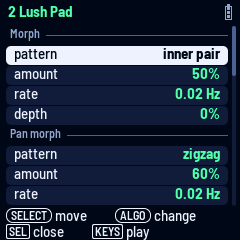

Hold any button on its own for a second, and a card explains what it does. Holding REC turns Bluetooth off or on
instead.

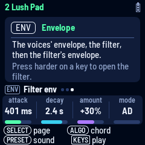

---

## 4. The screen

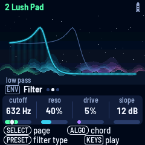

The top line shows the sound you're playing, with its number. A star after the name means you've changed the sound
since you picked it. A dot before the name means there are changes you haven't saved. The battery is at the right.
When you change something, a short message covers this line for a moment.

The picture in the middle shows the page. Behind every page, an aurora glows with your chord: each of the four
voices is a curtain of light in its own color, as bright as the voice is loud and placed where you hear it, from
left to right. The plate's share of the sound is a wide, faint glow under them.

Above the knobs, the button and the page's name show where you are. The dots after the name show how many pages the
button has, and which one you're on.

The four knobs show their names and values. A bar under each shows where it's set. When the sound itself moves a
setting, such as an LFO sweeping the filter, a small white dot shows where it is now.

The two lines at the bottom tell you what SELECT, ALGORITHM, PRESETS and the keys do on this page.

---

## 5. Sounds and saving

Turn PRESETS to step through the sounds. The first 57 are Chordism's own, and after them come the ones you've kept,
U1 to U16.

To see them all by name, press SEL on HOME. Turn SELECT to play each sound in turn, and press SEL again when you've
found the one you want.

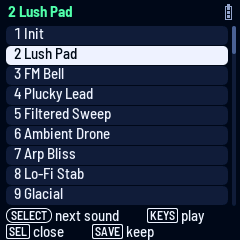

Changes you make to a sound play at once. Press SAVE to keep the sound as it is now, with your settings, for the
next time you switch on the FM-1. SAVE is lit while there are changes to save.

To keep a sound in one of your own slots, hold SAVE. The screen shows your 16 slots and what each one holds. Press a
white key, 1 to 16, to keep the sound in that slot. It then appears after the factory sounds as U1 to U16. If you let
go of SAVE without pressing a key, nothing is kept.

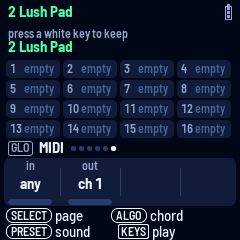

---

## 6. The pages

### HOME: Chord and Voicing

Use the Chord page to choose the chord. The picture shows its name and the notes of the chord you're playing.

| Knob | What it does |
| --- | --- |
| chord | Sets the kind of chord: octaves, fifth, minor, minor 7, minor 9, minor 11, major, major 7, major 9, sus 4, 6/9, minor 6, tenth, dominant 7, 7 flat 9 or half diminished. |
| spread | Sets how far apart the notes are. At 100% the chord is as written, at 0% the four voices play the same note, and at 200% the intervals are twice as wide. |
| width | Sets how far apart the voices sit in stereo. At 0% they're all in the middle, and at 100% voice 1 is at the left and voice 4 at the right. |
| volume | Sets the sound's volume. |

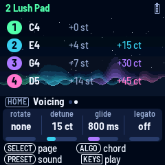

The Voicing page shows each voice's note, its interval from the key you press and its detune.

| Knob | What it does |
| --- | --- |
| rotate | Moves the chord's notes along the voices by one, two or three places, so each voice plays a different note of the chord with its own wave and place. |
| detune | Detunes the voices from each other, up to 50 cents per voice. |
| glide | Sets how long each voice slides from the last chord's note to the new one. |
| legato | With legato on, the voices slide only when you play the new key before letting go of the last. |

You hear every change on these pages at once, even on a chord you're holding.

### SEQ: Scale, Chord map and Intervals

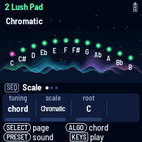

| Knob | What it does |
| --- | --- |
| tuning | Chooses how the chord is built. With chord, every key plays the chord from the Chord page. With map, each of the twelve notes plays its own chord, from the Chord map page. With interval, every key plays your own intervals, from the Intervals page. |
| scale | Fits the chord's notes into a scale, such as major, Dorian or the Hungarian minor. With chromatic, the notes stay as they are. |
| root | Sets the scale's first note. |

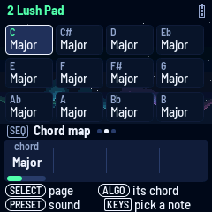

Use the Chord map to give each note its own chord, so that one finger plays the chords of a song. Press a key to
pick its note, then turn KNOB 1 or ALGORITHM to choose its chord. The map plays when tuning on the Scale page is set
to map.

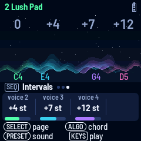

Use the Intervals page to build a chord of your own. Voice 1 always plays the note of the key you press, and the
knobs set the other three voices, up to two octaves up or down. The intervals play when tuning is set to interval.

### EDIT: Oscillators and FM

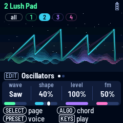

Each of the four voices has its own wave. Turn PRESETS to pick a voice, 1 to 4, or all of them, and the knobs set
it. The picked voice's wave is drawn bright, and the others faint.

| Knob | What it does |
| --- | --- |
| wave | Sets the wave: off, sine, triangle, saw, square, pulse or wavetable. |
| shape | Changes the wave. It folds a sine, tilts a triangle toward a saw, blends a saw with the octave above, sets a square's or a pulse's width, and sets how many partials the wavetable has. The knob shows what it does for the wave you've chosen. |
| level | Sets the voice's level. |
| fm | Sets how much the FM voice modulates this voice. With all voices picked, it sets the overall amount. |

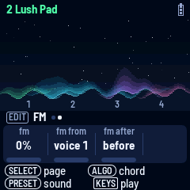

| Knob | What it does |
| --- | --- |
| fm | Sets how much one voice modulates the other three. |
| fm from | Chooses the voice that modulates the others. |
| fm after | With morph, the Morph page's levels change the modulation too. With before, they don't. |

### ENV: Envelope, Filter and Filter env

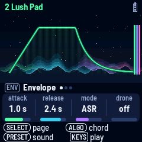

| Knob | What it does |
| --- | --- |
| attack | Sets how long the voices take to rise. |
| release | Sets how long they take to fade. |
| mode | With ASR, a chord holds while you hold the key. With AD, it fades on its own. With loop, it rises and fades again and again while you hold the key. |
| drone | With drone on, the voices play at full level all the time, without the envelope. |

The bars at the right of the picture show where each voice's envelope is now.

| Knob | What it does |
| --- | --- |
| cutoff | Sets the filter's cutoff. |
| reso | Sets the resonance. |
| drive | Drives the sound into a warm distortion. |
| slope | Sets how steep the high-pass and band-pass filters are, 12 or 24 dB. |

Turn PRESETS to choose the filter: low pass, high pass or band pass. The curve shows where the cutoff is now. When an
envelope, an LFO or your pressure moves it, the curve moves, and your setting stays behind it, faint.

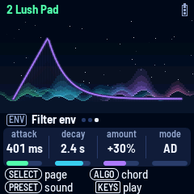

The filter has its own envelope. Set its attack, its decay and how far it moves the cutoff. The amount can be
negative, to close the filter instead. Its modes are as on the Envelope page.

### LFO: Shape LFO, Vibrato, Sweep, Filter LFO and Tremolo

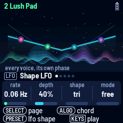

Each LFO page draws its LFO over one cycle, as deep as you've set it, with the full range faint behind it. The dots
show where it is now, and the line under the picture says what it moves.

The Shape LFO moves the four voices' shapes, each voice at its own point in the cycle. Set its rate, its depth, its
shape (triangle, ramp up, ramp down or square) and its mode. With free, it runs on its own. With retrig, it starts
again with each chord. With once, it plays one cycle for each chord. Turn PRESETS for the next shape. To set where
each voice sits in the cycle, press SEL.

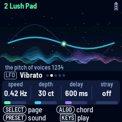

Vibrato wobbles the pitch. Set its speed, its depth in cents and how long it takes to come in after each chord. With
stray on, it wanders at random instead of swinging evenly. To choose which voices it moves, press SEL.

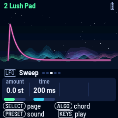

Sweep bends each chord into pitch as it starts. Set how far it starts from the note, up to an octave above or below,
and how long it takes to arrive.

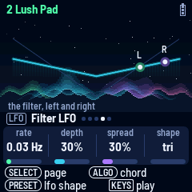

The Filter LFO sweeps the filter's cutoff. Use spread to sweep the left and right sides apart, for a sound that
moves across the stereo field.

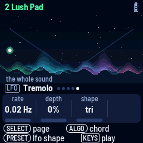

Tremolo wobbles the whole sound's level.

### FX: Plate, Shimmer, Delay and Lo-fi

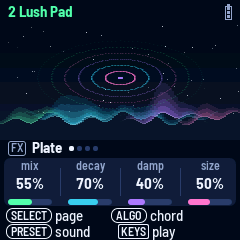

The plate is a stereo reverb. Set how much of it you hear, how long it rings, how dark its tail becomes and how big
it is. While it rings, rings of light spread from the middle of the picture. They spread as far as the plate is big
and fade as slowly as it decays.

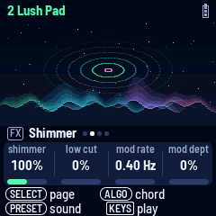

Use shimmer to make the plate's tail move. Below the middle it adds a chorus. Above the middle it also feeds the
tail back an octave up, so the reverb rises in octaves as it rings. Low cut thins the tail's bass. Mod rate and mod
depth set the chorus.

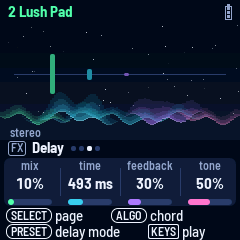

| Knob | What it does |
| --- | --- |
| mix | Sets how much of the delay you hear. |
| time | Sets the time between repeats, up to 1.4 seconds. |
| feedback | Sets how many times it repeats. |
| tone | Darkens each repeat. |

The picture shows the repeats, spaced by the time and each as loud as the feedback leaves it. The repeat you're
hearing lights up. Turn PRESETS to choose the delay's mode. Stereo repeats each side on its own. Ping-pong bounces the repeats between
the sides, and flip-flop swaps them from time to time. Long is one long mono delay. With zenith, each repeat comes
back an octave higher than the last. With interval, each repeat moves by the interval you set in the SEL list.

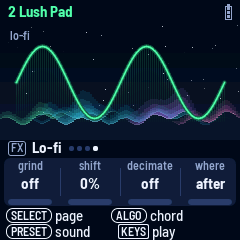

Use grind to reduce the sound's bits, and decimate to lower its sample rate. Shift changes the character of the
grind. With where, choose whether lo-fi comes after the filter or before it.

### ARP: Arp, Rhythm and Clock

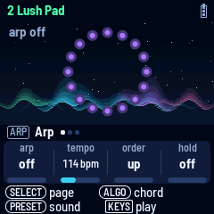

| Knob | What it does |
| --- | --- |
| arp | Turns the arpeggiator on or off. PLAY does the same. |
| tempo | Sets the speed, from 30 to 240 beats a minute. |
| order | Plays the keys you hold up, down, up and down, or at random. |
| hold | With hold on, the arp goes on after you let go of the keys. |

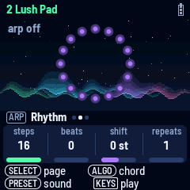

Use the Rhythm page to give the arp a Euclidean rhythm. Steps sets the length of the pattern, and beats sets how
many of those steps play, spread as evenly as they can be. With beats at 0, every step plays. Shift moves the notes
up or down each time the pattern comes round, and repeats sets how many times it does before it starts again.

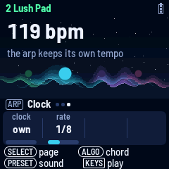

With clock set to MIDI, the arp follows the MIDI clock coming in, at the rate you choose. With own, it follows its
tempo. The page shows the tempo of the clock coming in, and a dot lights on each beat.

### GLO: Morph, Pan morph, Control, Control 2, Setup and MIDI

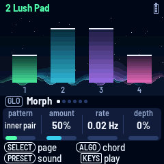

Use the Morph page to balance the voices. The pattern knob moves through 16 ways to set their levels, such as root
only, ramp up or inner pair, and blends from one to the next. Amount sets how far the voices follow the pattern.
Rate and depth set an LFO that moves through the patterns.

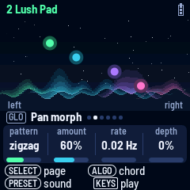

Pan morph does the same for the voices' places in the stereo field, with patterns such as L to R, split or zigzag.

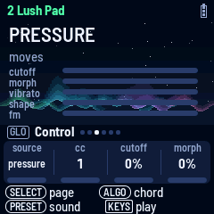

Use the Control pages to let your playing move the sound. Source chooses what moves it: your pressure on a key, a
random value or a coin toss with each chord, a MIDI CC, or how hard you strike. Then set how far it moves the
cutoff, the morph, the vibrato, the shape and the FM. Control 2 has the last three. With the source set to pressure
and cutoff at 0%, pressing a key harder opens the filter.

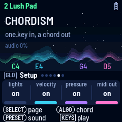

| Knob | What it does |
| --- | --- |
| lights | With on, the keys and the buttons light up. With keys, only the keys light up. With off, the lights stay off. |
| velocity | With velocity off, every key plays at the same loudness. |
| pressure | With pressure off, pressing a held key harder does nothing. |
| midi out | With midi out on, the keys send their notes over USB and Bluetooth. |

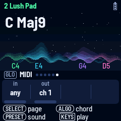

Use the MIDI page to choose the channel Chordism listens on, any or 1 to 16, and the channel its keys send on.

---

## 7. MIDI, audio and Bluetooth

Chordism plays notes that come in over USB, Bluetooth or the TRS input, on any channel or on the one you choose on
the MIDI page. It also takes polyphonic and
channel pressure, the CC chosen on the Control page, and the MIDI clock for the arp.

Over USB, the FM-1 is also an audio device, so your computer can record Chordism.

Press REC to look for Bluetooth MIDI devices, turn ALGORITHM to choose one, and press REC again to connect to it.
Hold REC for a second to turn Bluetooth off or on.

To see the FM-1's screen on your computer, open the mirror page on Chordism's site in Chrome or Edge.

---

## 8. The screen reader

Chordism tells the [FM-1 Screen Reader](https://charlesvestal.github.io/fm1-reader/) what its screen shows. The
reader says each page and its settings as you get there, reads the knobs as you turn them, and says the help cards.

---

## 9. Credits

Chordism is the Chordism module for Schwung (MIT), rebuilt for the FM-1. Its plate reverb comes from AMB-1. It's
built on fm1-base and felucca-bsp, from Felucca by Leo Kuroshita (Hügelton Instruments). Its Bluetooth is Optimist's
stack by Henri David (MPL-2.0). Its type is Barlow (SIL OFL 1.1).
